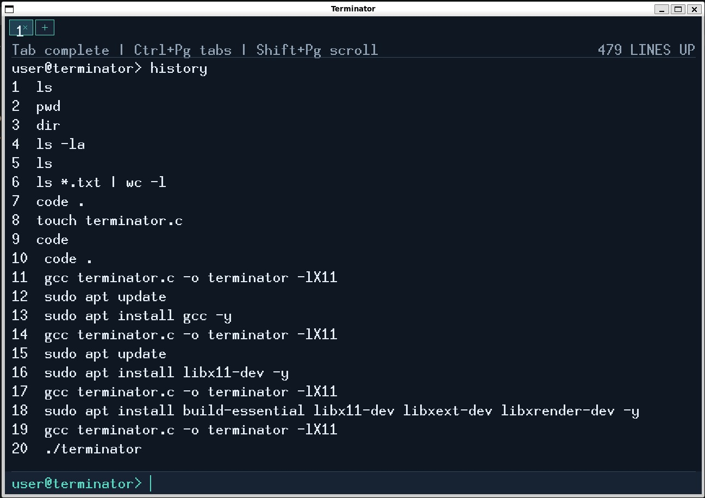
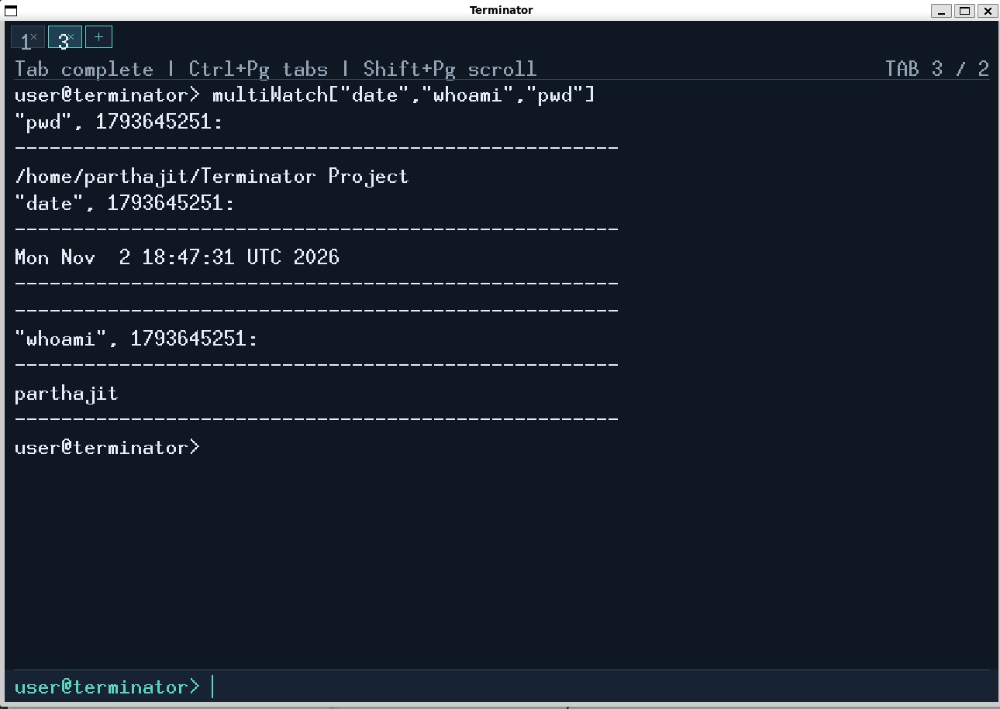

# Terminator

Terminator is a small C terminal emulator and command interpreter built with Xlib. It provides an X11 window with independent tabs, scrollback, editable command input, and shell-like command execution.

## Build and run

Terminator targets Linux with an X11 display. On Ubuntu or WSL with WSLg (or another X server) configured, install the compiler, Make, and Xlib development headers:

```sh
sudo apt update
sudo apt install build-essential libx11-dev
make
./terminator
```

`make` builds the executable as `./terminator`. The Makefile compiles `terminator.c` and links Xlib (`-lX11`) and pthread support (`-pthread`). A working X server and valid `DISPLAY` are required; configure WSLg or another X server before launching. The two worker modes are:

```sh
./terminator                    # one worker thread per tab
./terminator useProcess=True    # one worker process per tab
```

Use `make clean` to remove the generated executable.

## Features

- X11 window with up to 16 tabs, independent working directories, and independent scrollback.
- Extra-large 32-pixel fixed-font preference with fallbacks for X servers without that font.
- External commands, quoting, globbing, tilde expansion, command substitution, `;`, `&&`, `||`, and pipelines of up to 2,048 stages, subject to the 4,095-byte command limit and OS resources.
- `<`, `>`, `>>`, and `2>` redirection.
- Built-ins: `cd`, `exit`, `history`, `jobs`, `fg`, `bg`, `source`/`.`, `bash FILE`, `multiWatch`, variable assignment, and the `[ ... ]`/`test` predicates used by scripts.
- Background jobs with `&`; Ctrl+C interrupts the foreground process group and Ctrl+Z stops it.
- `multiWatch ["command", "command"]` runs up to 32 commands concurrently, prints Unix timestamps and dividers, then repeats every two seconds. Ctrl+C stops the watcher children.
- Shared persistent history in `~/.bash_history`, capped at 10,000 entries. `history` prints at most the latest 1,000. Up/Down browse history; Ctrl+R finds the newest exact command or the closest longest common substring longer than two characters.
- Tab filename completion. A unique match completes automatically; multiple matches extend the common prefix and show numbered choices. Type a listed number and press Enter to choose it.
- Editable input: Left/Right, Home/End, Backspace/Delete, Ctrl+A/E/U/K/W, and Shift+Left/Right selection.
- Ctrl+Shift+C/V copy and paste through X11 selections. Drag over output to select it. Ctrl+L clears the current tab's scrollback.
- Configurable shortcuts in `~/.terminatorrc`; see [`config/terminatorrc.example`](config/terminatorrc.example).
- Bash-style scripts are read and interpreted by Terminator, including comments, variables and positional arguments (`$0`, `$1`…`$9`, `$#`, `$?`), pipelines/redirections/substitutions, and nested `if`/`elif`/`else`/`fi` blocks with `[ ... ]`/`test` string equality, numeric comparisons, `-f`, and `-d`.

## Shortcuts

| Shortcut | Action |
| --- | --- |
| Tab | Complete filename |
| Ctrl+Page Up / Ctrl+Page Down | Previous / next tab |
| Ctrl+Shift+T / Ctrl+Shift+W | New / close tab |
| Ctrl+Shift+C / Ctrl+Shift+V | Copy / paste |
| Ctrl+R | Reverse history search |
| Ctrl+C / Ctrl+Z | Interrupt / stop foreground process group |
| Ctrl+A / Ctrl+E | Input start / end |
| Ctrl+U / Ctrl+K / Ctrl+W | Delete to start / end / previous word |
| Up / Down | Browse history |
| Shift+Page Up / Shift+Page Down | Scroll output |

Shortcut config lines use `bind ACTION MODIFIER+KEY`. Supported actions: `new-tab`, `close-tab`, `next-tab`, `previous-tab`, `copy`, `paste`, `search`, `clear`, `eof`.

```text
bind new-tab Control+Shift+T
bind next-tab Alt+Right
```

Invalid or conflicting lines are ignored and the default remains active. Ctrl+C and Ctrl+Z retain process-control behavior.

## Demo commands

Try these commands at the Terminator prompt to explore pipelines, redirection, history, and background jobs:

```sh
printf 'one\ntwo\n' | grep two
echo first > /tmp/terminator-demo.txt
cat /tmp/terminator-demo.txt
sleep 5 &
jobs
history
```

The `source`/`.` built-ins and `bash FILE` run supported shell-style scripts. Conditional blocks are checked for balanced structure before commands execute.

## Scope and limitations

This is a lab shell, not a POSIX/Bash replacement. It does not implement loops, functions, arrays, `case`, aliases, `export`, PTYs, or ANSI terminal rendering. Script conditionals must use the supported `if`/`elif`/`else`/`fi` structure and test operators. Input is limited to 4,095 bytes. Completion stores up to 32 matches, `multiWatch` accepts 32 commands, and each tab tracks up to 64 jobs. X11 clipboard support depends on the desktop selection manager.

## Tests

The `tests/` directory contains manual command fixtures and instructions. Run them from the project root inside Terminator with `source tests/<name>.sh`. They exercise commands, pipelines, redirection, jobs, worker concurrency, and `multiWatch`; see [`tests/README.md`](tests/README.md) for interactive steps and limitations.

## Screenshots

The `screenshots/` directory contains screenshots demonstrating the implemented features of Terminator.

### 1. Command History
Demonstrates the command history functionality.



### 2. Listing Files and Directories
Demonstrates execution of the `ls -l` command and display of file details.


### 3. MultiWatch
Demonstrates the MultiWatch feature, which allows multiple commands to be monitored simultaneously.



### 4. File Writing and Redirection
Demonstrates writing command output into a file using output redirection.


## Project files

- `terminator.c` — X11 UI, shell, job control, history, completion, and script interpreter.
- `Makefile` — build and clean targets with X11 and pthread flags.
- `README.md` — build, usage, feature, and limitation guide.
- `design.md` — architecture and data-structure notes.
- `config/terminatorrc.example` — sample shortcut configuration.
- `tests/` — manual command fixtures and run instructions.
- `screenshots/` — location and naming guide for genuine application captures.
- `.gitignore` — excludes generated binaries and common local metadata.
